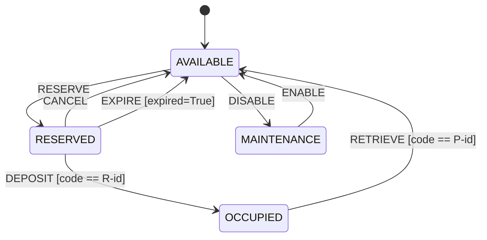

# State-Machine Model and Assumptions

Source: `data/requirements.md` and the assignment text (Sections 3.1–3.3). Implemented in
`locker/model.py`; the rule table there (built by `build_rules` from the tweakable facts in
`locker/rules_config.py`) is the authoritative version of everything below.

## States and variables

| State | Meaning |
|---|---|
| `AVAILABLE` | empty, can be reserved or disabled |
| `RESERVED` | reserved, parcel not yet deposited |
| `OCCUPIED` | parcel deposited, awaiting collection |
| `MAINTENANCE` | temporarily unavailable |

Extended state variables (all part of the observable `Snapshot`): `customer_id`, `reservation_code`
(`R-<customer>`), `retrieval_code` (`P-<customer>`). The expiry condition is the explicit Boolean
`Command.expired`; no wall-clock time is used. *Authentication status* and *maintenance status* are
encoded by the state itself (a retrieval is authenticated iff its code equals `retrieval_code`).

Every other (state, operation) combination, every wrong-code attempt, `EXPIRE` with
`expired=False`, and `INVALID_ACCESS` in any state is a **rejected self-loop** with no state change.
These are real model transitions (they are counted for coverage): 35 in total
(AVAILABLE 8, RESERVED 10, OCCUPIED 9, MAINTENANCE 8).

## Operations: preconditions, guards, effects

| Op | Precondition | Guard | Accepted → state / effect | Rejection (message) |
|---|---|---|---|---|
| RESERVE(id) | `AVAILABLE` | – | `RESERVED`; store id, `reservation_code=R-id` (`reserved`) | `locker_not_available` |
| CANCEL | `RESERVED` | – | `AVAILABLE`; clear all (`cancelled`) | `not_reserved` |
| DEPOSIT(code) | `RESERVED` | `code == reservation_code` | `OCCUPIED`; `retrieval_code=P-id` (`deposited`) | `not_reserved` / `invalid_reservation_code` |
| RETRIEVE(code) | `OCCUPIED` | `code == retrieval_code` | `AVAILABLE`; clear all (`retrieved`) | `no_parcel` / `invalid_retrieval_code` |
| EXPIRE(expired) | `RESERVED` | `expired is True` | `AVAILABLE`; clear all (`expired`) | `not_reserved` / `not_expired` |
| DISABLE | `AVAILABLE` | – | `MAINTENANCE` (`disabled`) | `cannot_disable` |
| ENABLE | `MAINTENANCE` | – | `AVAILABLE` (`enabled`) | `not_in_maintenance` |
| INVALID_ACCESS | – | – | never accepted | `invalid_access` |

Rejected operations never mutate state (requirement 12). Input classes exercised by the generators:
correct code, wrong code, empty code, the other credential type (cross-use), optionally a near-miss
code; two customer IDs; `expired` true/false.

## Invariants (`locker/oracle.py`)

* **I1** `AVAILABLE`/`MAINTENANCE`: no customer id, no codes.
* **I2** `RESERVED`: `reservation_code == R-<customer>`, no retrieval code.
* **I3** `OCCUPIED`: `retrieval_code == P-<customer>` and `reservation_code == R-<customer>`.
* **I4** state ∈ {the four defined states}.
* **R12** a rejected operation leaves the SUT snapshot identical (checked from the SUT's own
  before/after snapshots, independent of the model).

## Assumptions (policy decisions the assignment leaves open)

* **A1** `CANCEL` is permitted only in `RESERVED`; an `OCCUPIED` locker cannot be cancelled.
* **A2** `DISABLE` is permitted only in `AVAILABLE` (a compartment holding a parcel/reservation cannot
  enter maintenance), as stated in §3.3.
* **A3** The reservation code stays stored while `OCCUPIED` and is cleared with everything else on
  retrieval (requirement 7 says "all customer and credential data").
* **A4** Expired reservation → immediate `AVAILABLE`, all data cleared (§3.3, §6).
* **A5** `EXPIRE` while not `RESERVED` is rejected regardless of the `expired` flag.
* **A6** Credentials are compared by exact string equality; an empty string is just a wrong code.
* **A7** Customer IDs are arbitrary strings; an empty ID is not generated and left unspecified.
* **A8** The oracle also compares `Result.message`. The spec fixes only `Result(accepted, message)`;
  the message vocabulary (e.g. `invalid_retrieval_code`) is **an assumption taken from the supplied
  SUT's observable output**. Construct `SequenceRunner(compare_messages=False)` to compare only the
  `accepted` flag if your instructor says message text is not part of the contract.
* **A9** One compartment is modelled; extension to several compartments is not attempted.

## Coverage definitions (`locker/metrics.py`)

* State coverage = visited states / 4 (initial state counts).
* Transition coverage = distinct (src, op, outcome, dst) exercised / 35.
* Transition-pair coverage = distinct adjacent pairs (t₁, t₂) exercised / 305, where (t₁, t₂) is
  *defined* iff `t₁.dst == t₂.src`. Rejections are self-loops so they participate. All 305 pairs are
  realisable because a transition depends only on the abstract state and the input class.
* Mutation score = detected / (all mutants − equivalent mutants).

## Oracle independence

The model is a declarative rule table whereas the SUT is an imperative if-chain, so a copied logic bug
is unlikely; the model never imports the SUT; and invariants I1–I4/R12 are checked on the SUT alone.
Residual risk: both model and SUT were derived from the same prose, and message strings follow A8.
